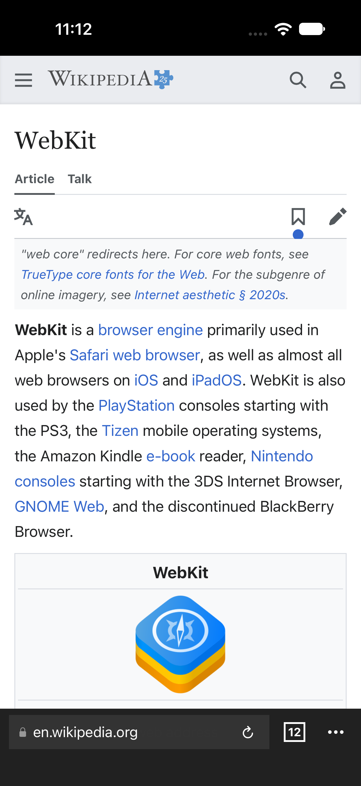
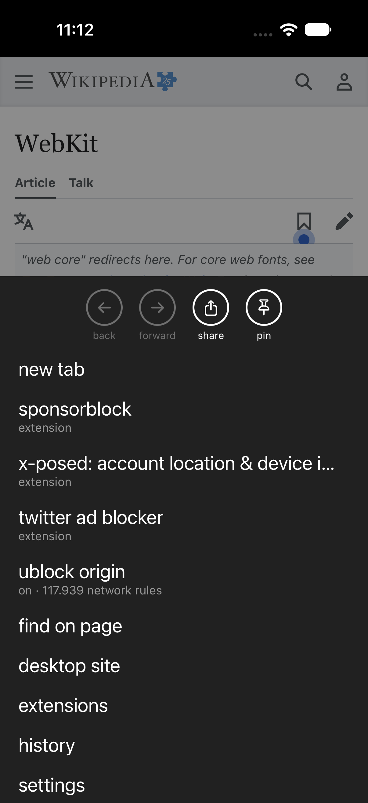
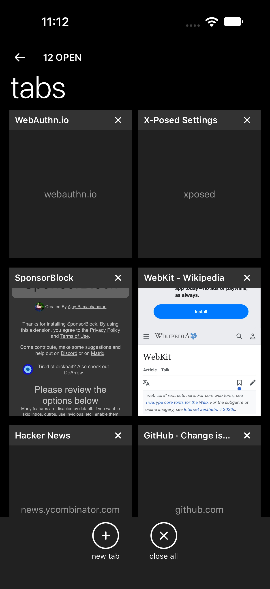
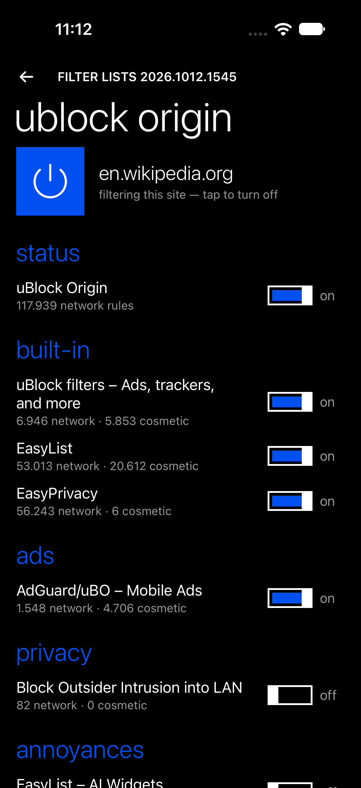
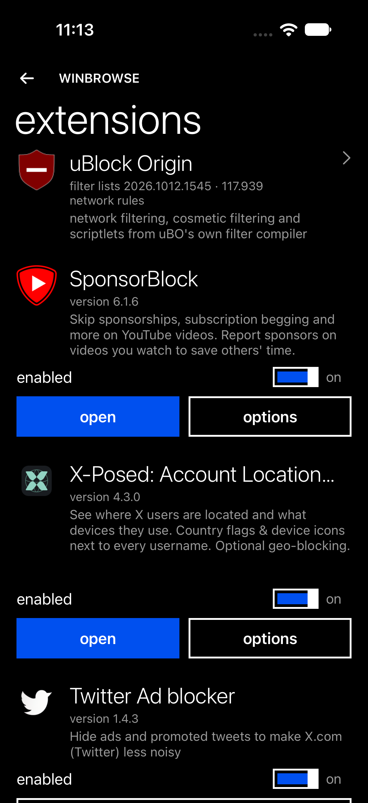
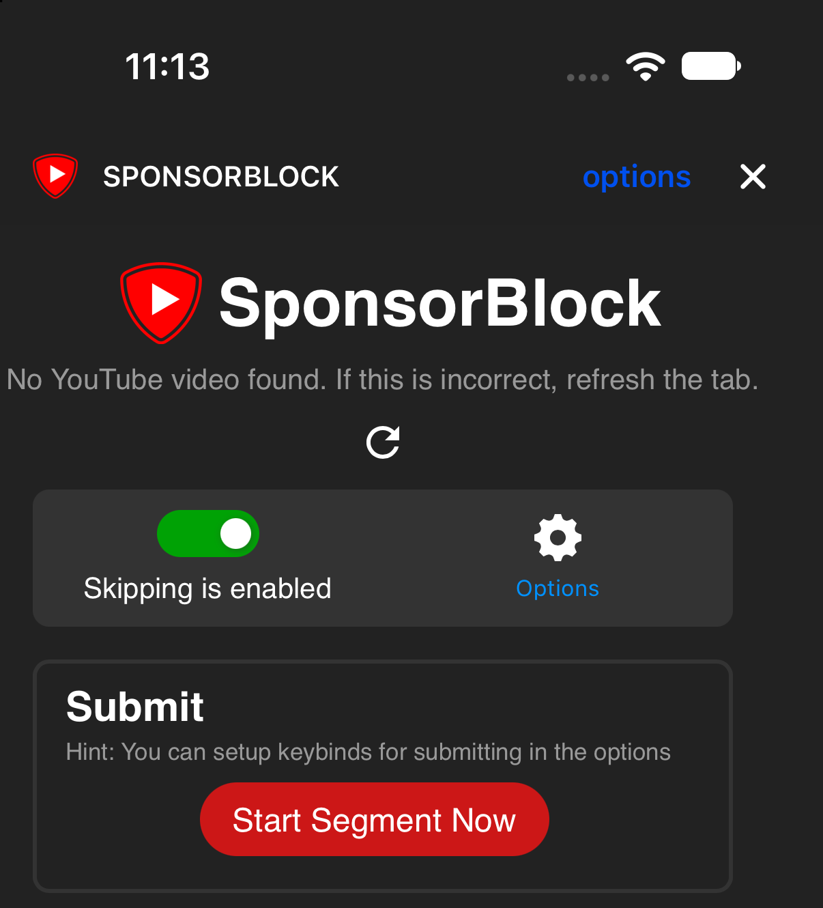
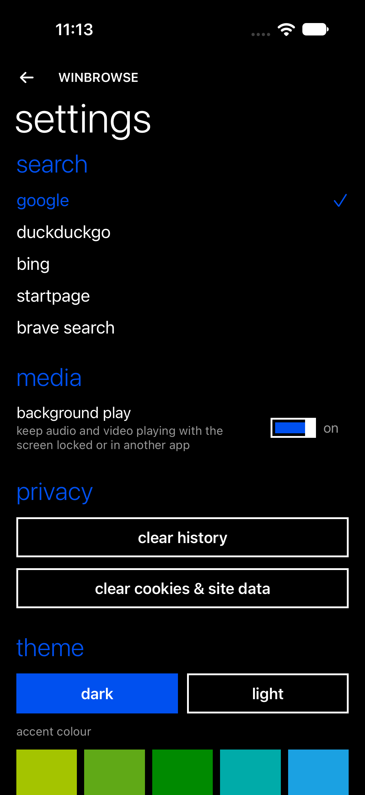

<div align="center">


# WinBrowse

**A Windows 10 Mobile styled WebKit browser for iOS & iPadOS with desktop-class extension support, uBlock Origin Lite, SponsorBlock, and background media playback.**

[](https://developer.apple.com/ios/)
[](https://swift.org/)
[](LICENSE)
[](https://sidestore.io/)
[](#)

</div>

---

## Overview

**WinBrowse** brings back the beloved Metro / Modern UI of Windows 10 Mobile and Windows Phone (Edge + Groove) to modern iOS and iPadOS devices. Behind the fluid typography and tilt animations is a custom **Chrome WebExtension runtime** executing on Apple's WebKit engine alongside native content blocking with over **114,000 active filter rules**.

Unlike browsers that require JIT or modified WebKit frameworks, WinBrowse runs cleanly within standard iOS capabilities—making it fully installable via **SideStore**, **AltStore**, **TrollStore**, or Xcode.

---

## Screenshots

<div align="center">

| Web Browsing & Metro App Bar | Metro Menu Overlay | Tab Switcher Cards |
| :---: | :---: | :---: |
|  |  |  |

| uBlock Origin Lite Panel | Extension Manager | SponsorBlock MV3 Popup |
| :---: | :---: | :---: |
|  |  |  |

| Settings & Metro Accent Colors |
| :---: |
|  |

</div>

---

## Built-In Extensions & Features

| Feature / Extension | Implementation Details |
| :--- | :--- |
| **SponsorBlock 6.x** | The **real Chrome Web Store extension build** (MV3) running on WinBrowse's `chrome.*` shim. Content scripts inject into YouTube, the background worker tracks segments, and the popup/options sheets provide interactive segment management. Automatically skips sponsors, intros, outros, self-promos, previews, and interaction reminders. |
| **uBlock Origin Lite** | Official uBO WebKit engine (uBO Lite for Safari). Its compiled filter lists become WebKit content-rule lists (**~114,000 network rules active** by default). Injects cosmetic element-hiding filters, procedural filters, and scriptlets for YouTube and streaming ad circumvention. Includes per-site toggle and filter list customization (EasyList, EasyPrivacy, AdGuard Mobile, Annoyances, Block LAN). |
| **X-Posed 4.x** | The authentic X-Posed extension: displays geolocation country flags, account creation dates, and client information next to X (Twitter) handles. Background scripts communicate through a native cookie-forwarding fetch proxy. |
| **The Ad Blocker for X** | Strips promoted ads, "Who to follow" recommendations, and sponsored threads directly from X's timeline via combined DOM observer and timeline JSON response interception. |
| **Background Playback** | Keeps YouTube and web media playing when backgrounded or locked. Injects `document.visibilityState === "visible"` spoofing, configures `AVAudioSession` to `.playback`, automatically resumes paused WebKit playback, and integrates with Control Center / lock screen media controls. |
| **Passkeys** | WinBrowse is its own WebAuthn authenticator (ES256). Keys are created on the device, kept in the iOS keychain, and unlocked with Face ID or the passcode for each use. Keys are not synced or backed up. Sites see a platform authenticator. Manage saved passkeys in Settings → passkeys. |
| **Windows Phone Metro UI** | Clean, blank new-tab page, panoramic pivots, 3D tilt press animations, collapsible bottom app bar, and customizable Windows accent color palette (Cobalt, Crimson, Emerald, Amber, Violet, Cyan, Magenta, Lime, Orange, Steel). |
| **Local Debug Control Port** | Embedded HTTP debug server listening on `localhost:8899` allowing CLI automation, remote URL opening, tab state querying, and JavaScript execution into page or extension worlds. |

---

## Extension Runtime

WinBrowse provides an isolated, standards-aligned extension environment bridging WebKit with the WebExtension API:

- **Isolated Execution (`WKContentWorld`)**: Each extension's content scripts run inside their own isolated `WKContentWorld`. Scripts configured with `"world": "MAIN"` execute directly in the page world.
- **`chrome.*` API Bridge**: Implemented in `App/Resources/winext-shim.js` and `App/Extensions/ExtensionHost.swift`:
  - `chrome.runtime`: messaging (`sendMessage`, `onMessage`), connect ports (`connect`, `onConnect`), `getURL`, `getManifest`, `id`.
  - `chrome.tabs`: `query`, `get`, `create`, `update`, `remove`, `sendMessage`, `onActivated`, `onUpdated`, `onRemoved`.
  - `chrome.storage`: `local`, `sync`, `session` storage areas with asynchronous persistence and `onChanged` event dispatching.
  - `chrome.i18n`: localized string lookups from extension `_locales/`.
  - `chrome.scripting`: programmatic script injection into target tabs.
  - `chrome.alarms`: scheduled timer events for background workers.
  - `chrome.permissions` & `chrome.windows`: browser window and permission queries.
- **Service Workers & Custom Scheme**: Background workers run in headless web views over the internal `winext://<id>/` scheme handled natively by `WinextSchemeHandler`.
- **Extension UI Pages**: Popup pages and option tabs are loaded from the app bundle and presented in native modal sheets.

---

## Installation

### SideStore / AltStore (Recommended)
1. In SideStore, navigate to **Sources** &rarr; tap **+** (Add Source).
2. Enter the source URL:
   ```text
   https://example.workers.dev/source.json
   ```
3. WinBrowse will appear in your app list ready to install and receive one-tap updates.
4. Alternatively, download an unsigned `.ipa` from a CI run's artifacts on the ci-server instance (see [CI](#ci)) and sideload it.

### TrollStore (iOS 15.0 – 17.0)
Download the unsigned IPA from a CI run's artifacts (see [CI](#ci)) and open it directly with TrollStore for permanent, revokeless installation.

---

## Building from Source

### Prerequisites
- macOS Sonoma (14.0+) or macOS Sequoia
- Xcode 15.0+ or Xcode 16+
- [XcodeGen](https://github.com/yonaskolb/XcodeGen) (`brew install xcodegen`)
- Command Line Tools (`xcode-select --install`)

### Quick Start
```bash
# Clone the repository
git clone https://ci.example/ci-user/winbrowse.git
cd winbrowse

# Generate Xcode project from project.yml
xcodegen generate

# Open in Xcode
open WinBrowse.xcodeproj
```
Select the **WinBrowse** scheme, choose your connected device or simulator, and hit **Run** (⌘R).

### Simulator Automation
To build and launch automatically on a booted iOS Simulator:
```bash
scripts/sim.sh
```

### Building Unsigned Release IPA
To compile a release build and package an unsigned `.ipa` into `dist/`:
```bash
scripts/build-ipa.sh
```

### CI

Builds run on the ci-server instance on the CI server over private network; the iOS job runs on a host-mode Mac runner. Push to `main` for an unsigned IPA artifact; push a
`v*` tag to also publish it to the SideStore source. Details in **[docs/ci.md](docs/ci.md)**.

### Updating Extension Rules & Bundles
To fetch the latest Chrome Web Store CRX packages and compiled uBlock Origin Lite rulesets:
```bash
scripts/update-extensions.sh
```

---

## Developer Control Port (`localhost:8899`)

When running in `DEBUG` configuration, WinBrowse hosts an embedded HTTP server on `localhost:8899` (loopback only) to assist with testing and terminal automation. Every request must send the per-run token from `/tmp/winbrowse-debug-token` in an `X-Debug-Token` header:

```bash
# Open a URL in the active tab
curl -H "X-Debug-Token: $(cat /tmp/winbrowse-debug-token)" 'localhost:8899/open?url=https://en.wikipedia.org'

# Open a URL in a new tab
curl -H "X-Debug-Token: $(cat /tmp/winbrowse-debug-token)" 'localhost:8899/open?url=https://news.ycombinator.com&new=1'

# Inspect browser state (open tabs, active tab, uBO status, rule count)
curl -H "X-Debug-Token: $(cat /tmp/winbrowse-debug-token)" 'localhost:8899/state'

# Execute JavaScript in page world
curl -H "X-Debug-Token: $(cat /tmp/winbrowse-debug-token)" -d 'document.title' 'localhost:8899/eval?world=page'

# Execute JavaScript in an extension content script world
curl -H "X-Debug-Token: $(cat /tmp/winbrowse-debug-token)" -d 'chrome.runtime.id' 'localhost:8899/eval?world=ext:sponsorblock'

# Execute JavaScript in an extension background service worker
curl -H "X-Debug-Token: $(cat /tmp/winbrowse-debug-token)" -d 'console.log("ping from CLI")' 'localhost:8899/eval?world=bg:sponsorblock'

# Toggle bottom Metro menu
curl -H "X-Debug-Token: $(cat /tmp/winbrowse-debug-token)" 'localhost:8899/menu'

# Navigate routes (tabs, settings, extensions, ublock, history, passkeys)
curl -H "X-Debug-Token: $(cat /tmp/winbrowse-debug-token)" 'localhost:8899/route?r=tabs'
curl -H "X-Debug-Token: $(cat /tmp/winbrowse-debug-token)" 'localhost:8899/route?r=ublock'
curl -H "X-Debug-Token: $(cat /tmp/winbrowse-debug-token)" 'localhost:8899/route'          # pops back to browser view

# Passkeys: auto=1 approves sign-in and sign-up prompts without UI, auto=0 shows them; list=1 prints saved passkeys
# (no key material); delete=<credential id> removes one; clear=1 removes all
curl -H "X-Debug-Token: $(cat /tmp/winbrowse-debug-token)" 'localhost:8899/passkeys?auto=1'
curl -H "X-Debug-Token: $(cat /tmp/winbrowse-debug-token)" 'localhost:8899/passkeys?list=1'

# Trigger extension popup modal
curl -H "X-Debug-Token: $(cat /tmp/winbrowse-debug-token)" 'localhost:8899/popup?ext=sponsorblock'

# Toggle uBlock Origin for a specific site
curl -H "X-Debug-Token: $(cat /tmp/winbrowse-debug-token)" 'localhost:8899/ubo?site=example.com&off=1'

# Select tab by index
curl -H "X-Debug-Token: $(cat /tmp/winbrowse-debug-token)" 'localhost:8899/select?i=0'
```

---

## Project Structure

```text
winbrowse/
├── App/
│   ├── Assets.xcassets/         # App icons, accent colors, launch backgrounds
│   ├── Blocker/                 # uBlock Origin Lite rule compilation & script injection
│   │   ├── ContentBlocker.swift # WebKit rule-list compilation and filter management
│   │   └── UBOScripts.swift     # Cosmetic, procedural, and scriptlet injectors
│   ├── Browser/                 # Core browser state and WebView management
│   │   ├── BrowserStore.swift   # Tab lifecycle, history, and persistence
│   │   ├── DebugServer.swift    # Embedded localhost:8899 control server
│   │   ├── PasskeyCodec.swift   # WebAuthn byte formats: authenticator data, attestation, ES256 signatures
│   │   ├── Passkeys.swift       # Passkey authenticator: keychain storage, prompts, page bridge
│   │   ├── Tab.swift            # WKWebView container and navigation state
│   │   └── WebViewFactory.swift # UserContentController and WKProcessPool setup
│   ├── Extensions/              # WebExtension runtime implementation
│   │   ├── ExtensionHost.swift  # chrome.* API message dispatcher and background workers
│   │   ├── ExtensionStorage.swift # Local/sync/session storage engines
│   │   ├── WebExtension.swift   # Manifest parser and content script matcher
│   │   └── WinextSchemeHandler.swift # Custom winext:// protocol asset handler
│   ├── Extensions-bundle/       # Bundled extension assets & uBO rulesets
│   │   ├── sponsorblock/        # SponsorBlock extension (MV3)
│   │   ├── ubo/                 # uBlock Origin Lite WebKit rulesets
│   │   ├── xadblock/            # The Ad Blocker for X
│   │   └── xposed/              # X-Posed extension
│   ├── Media/                   # Background audio & media session handling
│   │   └── BackgroundMedia.swift # AVAudioSession .playback and visibilityState spoofing
│   ├── Resources/               # Runtime JavaScript polyfills
│   │   ├── compat-xadblock-main.js # Timeline interception scripts
│   │   ├── passkeys.js          # navigator.credentials shim for WebAuthn sign-in and sign-up
│   │   └── winext-shim.js       # chrome.* client-side polyfill
│   ├── UI/                      # SwiftUI views and Metro interface
│   │   ├── BrowserView.swift    # Main browser interface with bottom app bar
│   │   ├── ExtensionViews.swift # Extension popups and settings views
│   │   ├── MenuOverlay.swift    # Metro bottom menu overlay
│   │   ├── PasskeysView.swift   # Saved passkeys list, opened from Settings
│   │   ├── SettingsView.swift   # Settings and theme customization
│   │   ├── StartPage.swift      # New-tab page (intentionally blank)
│   │   └── Metro/               # Metro design system controls, pivots, and fonts
│   └── WinBrowseApp.swift       # App lifecycle entry point
├── assets/
│   └── screenshots/             # High-resolution screenshots for documentation
├── .forgejo/workflows/ios.yml   # CI: unsigned IPA build, tag-triggered publish
├── deploy/                      # Cloudflare Workers SideStore source & asset deploy
├── docs/ci.md                   # CI/release documentation
├── scripts/
│   ├── build-ipa.sh             # Packages unsigned release IPA
│   ├── patch-xadblock.py        # Re-applies our fixes to the vendored X ad blocker
│   ├── publish.sh               # Builds IPA (or takes one via IPA=) and deploys SideStore source
│   ├── sim.sh                   # Simulator build and launch runner
│   └── update-extensions.sh     # Upstream extension updater
├── project.yml                  # XcodeGen declarative project spec
└── README.md
```

---

## Third-Party Notices & Licenses

WinBrowse bundles third-party software and extensions, each retaining their respective open-source licenses:

- **uBlock Origin Lite**: Copyright (c) Raymond Hill. Licensed under the [GNU General Public License v3.0 (GPL-3.0)](https://github.com/uBlockOrigin/uBOL-home/blob/master/LICENSE.txt).
- **SponsorBlock**: Copyright (c) Ajay Ramachandran. Licensed under the [GNU Lesser General Public License v3.0 (LGPL-3.0)](https://github.com/ajayyy/SponsorBlock/blob/master/LICENSE).
- **Lucide Icons**: Copyright (c) Lucide Contributors. Licensed under the [ISC License](https://github.com/lucide-icons/lucide/blob/main/LICENSE).

---

## License

WinBrowse is licensed under the [MIT License](LICENSE).
