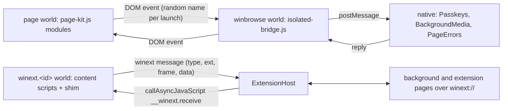

# Architecture

WinBrowse is one iOS app target built from `project.yml`. Everything runs inside WKWebView; there is no private API and no JIT.

## Start-up

`WinBrowseApp.init` restores files from the keychain vault after a reinstall (`Vault.restoreFilesIfFreshInstall`), before any singleton reads settings. When the first view appears, `AppBoot.boot` runs once:

1. Put saved cookies back into WebKit's cookie store, so no tab loads without them.
2. Load the bundled extensions (`ExtensionHost.load`) and build the script controllers (`WebViewFactory.rebuildScripts`).
3. Restore tabs (`BrowserStore.restore`). Restored tabs stay cold until shown.
4. Compile or load the filter lists (`ContentBlocker.prepare`), install them, and reload the active tab if it loaded before the filters were ready.
5. Start the extensions' background pages 0.3 s later. They are hidden web views inserted into the key window, because WebKit throttles timers in web views that are not in a window.
6. In Debug builds, start the control port (`DebugServer`).
7. Read the real user agent from a throwaway web view; the extension fetch proxy sends it.

When a test bundle hosts the app, steps 1–7 and the vault restore are skipped.

## Who decides what runs on a page

`SitePolicy` (`App/Browser/SitePolicy.swift`) is the only place that decides which protections apply to a host: network blocking, cosmetic filters, scriptlets, background play and passkeys. It combines the global switches, the user's per-site choices (`SiteSettings`) and the bundled defaults in `App/Resources/site-config.json`. Subdomains inherit, `www.` is ignored, and "proceed" on a blocked page lifts only network blocking for that site.

`WebViewFactory` builds one `WKUserContentController` per protection set, on demand. A `Tab` asks the policy for the URL it is about to load. If the answer differs from its current web view's set, it builds a new web view (keeping back-forward navigation in the old one when the user goes back). A popup adopts the configuration WebKit hands it, so it inherits its opener's protections.

A tab is in one of four states (`Tab.Life`): cold (a URL, no web view), suspended (saved interaction state), live, or terminated (the web content process died; it reloads when shown, not all at once in the background). `BrowserStore` keeps about three live background tabs per GB of RAM, at least six, and sheds the least recently used half only on a real memory warning. Tabs that play media are never discarded.

## Content worlds

| World | What runs there | Talks to native through |
|---|---|---|
| page | `page-kit.js` with the media, passkeys and X timeline modules; uBlock Origin Lite main-world scriptlets; extension scripts declared `"world": "MAIN"` | nothing directly: app modules send a DOM event to the `winbrowse` world |
| `winbrowse` | `isolated-bridge.js`, `isolated-media.js`, `isolated-errors.js` | `winpasskey`, `winmedia`, `winerror`, `winlog` |
| `ubo` | uBlock Origin Lite cosmetic and procedural filters, isolated scriptlets | `ubo` (site-specific selectors) |
| `winext.<id>` | each extension's content scripts and its `chrome.*` shim | `winext` |
| extension pages and background pages (`winext://<id>/…`) | the extension's own pages with the shim | `winext` |

The page modules keep the replaced functions' names, lengths, descriptors and native source text, so sites cannot tell them from WebKit's own; `docs/footprint.md` lists every difference a site can observe and the test that checks it.

## Extension runtime

`ExtensionHost` runs unmodified Chrome extensions. Every message from the shim names an `ExtensionMessage` type. The host checks the caller from the content world's name, or from the `winext://<id>` origin for extension pages, and refuses types that content scripts may not use (tabs, scripting, fetch, popups). Content-script frames are identified by an ID the shim picks for each document. Background pages are `loading`, `ready` or `failed`; messages wait for `loading` and fail fast on `failed`.

`WinextSchemeHandler` serves extension files. Web pages may load only the files the manifest marks as web-accessible for that site (`ExtensionFiles.loadable`), and only those responses carry CORS headers. `NativeFetch` gives extension pages cross-origin fetch with the browser's cookies, limited to the manifest's host permissions; it drops cookies when a redirect leaves the host and never exposes `Set-Cookie`.

SponsorBlock gets one default on first run: every skippable category auto-skips (its own default skips only sponsors).

## Filter lists

`RuleConverter` turns uBlock Origin Lite's declarativeNetRequest rules into WebKit content-rule JSON and names a reason for every rule it cannot express. `ContentBlocker.prepare` compiles the result in chunks of up to 140,000 rules. Each chunk carries all exception rules, because an exception cancels blocks only within its own list. Exceptions are compiled alone first; a chunk that WebKit refuses is bisected (`RuleListCompiler`) until only the refused rules are left out. The `CompileReport` (converted, dropped by reason, refused, WebKit's first error) is cached with the lists, shown on the uBlock screen and included in breakage reports. Compiled lists are cached under a signature of the filter-list version, the converter revision and the enabled lists.

## Passkeys

A sideloaded app cannot reach iCloud Keychain passkeys from a web view, so WinBrowse is its own authenticator: ES256 keys in the keychain (this device only), each use confirmed with Face ID or the passcode. The native side builds `clientDataJSON` from the requesting frame's real origin, accepts a relying-party ID only if it is the host or a registrable parent of it (Public Suffix List), refuses cross-origin frames and tabs that are not on screen. Authenticator data never sets the backup-eligible or backed-up bits, because keys never leave the device. The sign count is always 0, which WebAuthn allows.

## Background media

Pages that have played unmuted sound are told they stay visible and focused, so players do not pause themselves when the app goes to the background. WebKit still pauses media as the app leaves the foreground; `BackgroundMedia` resumes elements that were playing, during the first four seconds in the background, unless the user paused them (a tap, key or lock-screen pause within 1.5 s).

## Diagnostics

Debug builds open a control port on `localhost:8899` (loopback only, per-run token); `/help` lists its routes. `tools/webcompat/wb.py` drives it to reproduce and bisect site breakage (`docs/triage.md`). Release builds offer "report broken site", which shares a redacted JSON report and sends nothing on its own.
